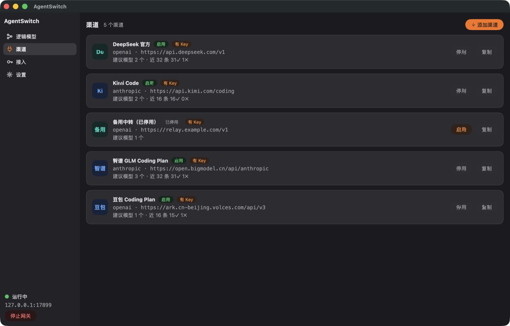
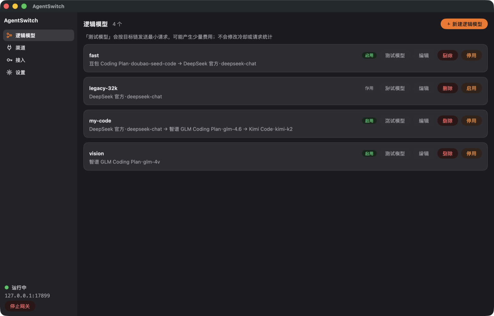
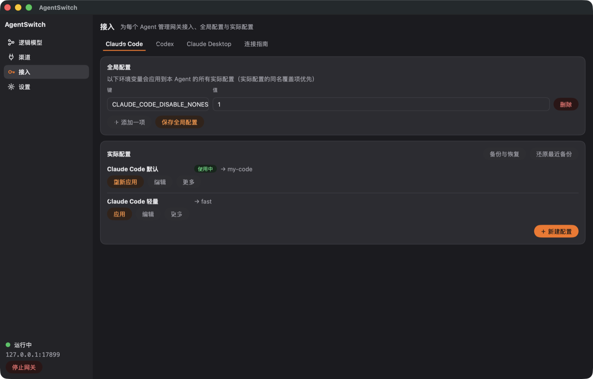
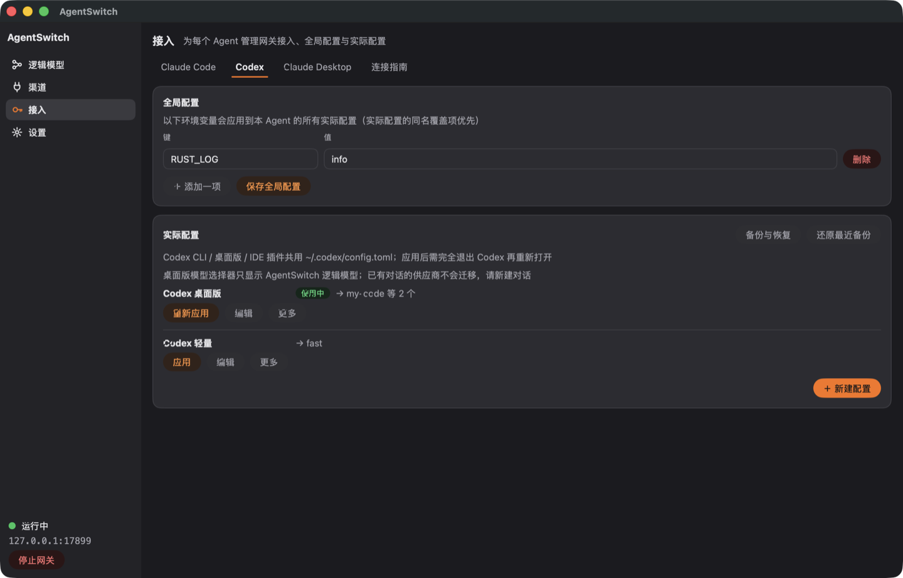
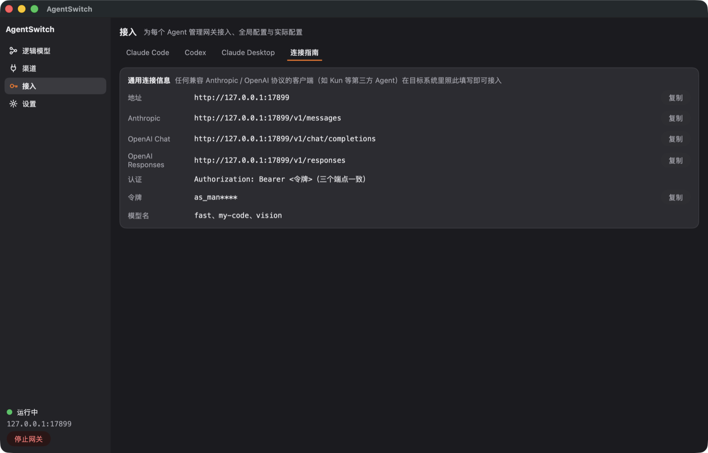
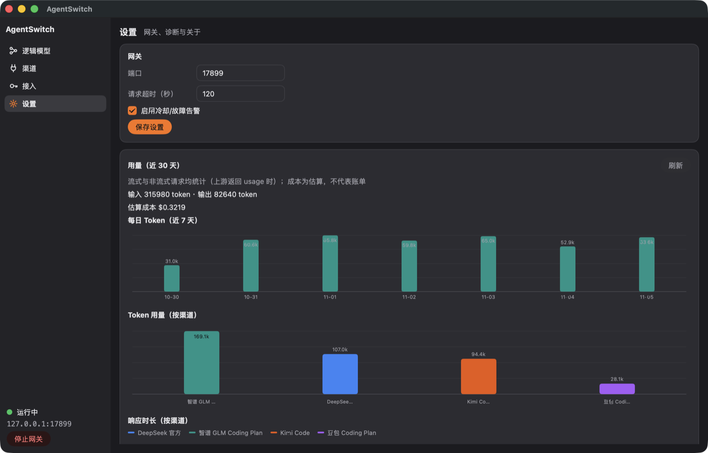

# AgentSwitch 使用手册

> 适用版本：v0.1.0。截图使用演示数据，渠道、Key、用量均为示例，不代表真实账户。

AgentSwitch 是跑在本机的模型 API 网关：Claude Code、Codex、Claude Desktop 等 Agent 只连接
`http://127.0.0.1:17890`，由网关负责选择上游供应商、协议转换、冷却与故障转移。

三个核心概念：

| 概念 | 作用 |
|------|------|
| **渠道** | 一个上游入口：协议（Anthropic / OpenAI）+ Base URL + 一个 API Key |
| **逻辑模型** | Agent 请求的模型名（如 `my-code`）+ 有序目标链（渠道 + 模型） |
| **接入** | 把网关地址、令牌、模型名写入某个 Agent 的真实配置文件 |

---

## 1. 安装与启动

| 平台 | 方式 |
|------|------|
| macOS（Intel） | 下载 `AgentSwitch.0.1.0.amd64.dmg`，拖入 Applications |
| macOS（Apple Silicon） | 通过 Rosetta 运行 x64 包（原生 arm64 尚未验证） |
| Windows 10/11 x64 | 解压便携包，运行 `AgentSwitch.exe`（`icon.png` 需同目录） |
| Linux（GTK3） | `go tool mygo build`，使用 `build/linux-amd64/` 下的安装脚本 |

首次启动后网关自动运行，侧栏底部显示实际监听地址与状态。**关闭窗口不会停止网关**，
应用驻留托盘；需要停止时点底条「停止网关」并确认。

数据目录：

- macOS：`~/Library/Application Support/AgentSwitch/`
- Linux：`~/.config/AgentSwitch/`
- Windows：`%APPDATA%\AgentSwitch\`

---

## 2. 三步完成配置

### 2.1 建渠道



1. 渠道页点「添加渠道」，从 20 条预置中选一家（14 家按量 + 6 家 Coding Plan 订阅）。
2. 选择协议后，`base_url` 与建议模型会自动带出；也可以手填自定义中转站。
3. 每个渠道填**一个** API Key。Key 以 AES-256-GCM 加密存入 SQLite，明文不落盘。
4. 渠道列表里可以：
   - **停用 / 启用**：停用后不再参与路由；
   - **复制**：复制 Base URL、协议与建议模型，默认不复制 Key，适合做同渠道的主备副本；
   - **拉取模型**：调用上游 `/v1/models` 自动填充建议模型（`openai` / `anthropic` 分别鉴权）。

> 自建中转站若是私网 / localhost 地址，需要在表单里显式允许私网（`allowPrivate`）。
> 内置预置则强制要求公网 HTTPS。

### 2.2 建逻辑模型与目标链



1. 逻辑模型页点「新建逻辑模型」，名字就是 Agent 请求的模型名（如 `my-code`）。
2. 在目标链里按优先级添加「渠道 + 该渠道上的模型」，越靠前越优先。
3. 请求失败时，网关只在**响应尚未提交给客户端**前切换到下一目标；已经开始的流不会重放。
4. 「测试模型」会按目标链发送一个最小请求，逐个显示成功/失败、耗时与错误分类。
   该操作会消耗少量额度，但**不会**修改冷却状态或请求统计。
5. 停用逻辑模型后，网关对该模型名返回明确错误（未登记模型默认拒绝）。

示例目标链：

```
my-code
  ├─ 1  DeepSeek 官方 · deepseek-chat
  ├─ 2  智谱 GLM · glm-4.6
  └─ 3  Kimi Code · kimi-k2
```

### 2.3 应用接入



接入页（Agent 接入）按 Agent 分页签，每个页签包含：

- **接入摘要**（Claude）：网关状态、当前配置/模型与「编辑接入 / 应用接入」；
- **配置列表**：任意多份配置，其中一份为「使用中」。绑定一个逻辑模型（Codex 绑定默认模型 +
  有序模型列表；Claude 另有主模型 / 回退模型 / 角色显示名，均为下拉选择、显示名随模型自动填充
  可手改）。行上「更多」菜单提供复制启动命令 / 打开终端 / 删除；
- **全局配置**（仅 Codex）：对该 Agent 的所有实际配置生效的环境变量（同名键会被实际配置覆盖）。
  Claude 的全局配置已下线，环境变量在「Claude Code 设置」页管理。

**「仅保存」只写入 AgentSwitch；「应用」才会改写 Agent 的真实配置文件。** 写入前会自动备份到
`~/.agentswitch/backups/`，列表卡的「备份与恢复」可以查看历史备份并还原（还原前会再快照当前状态）。

| Agent | 写入文件 |
|-------|---------|
| Claude Code | `~/.claude/settings.json`（只改受管 env 键） |
| Codex | `~/.codex/config.toml` + `~/.codex/agentswitch-model-catalog.json`（不改 `auth.json`） |
| Claude Desktop | macOS `~/Library/Application Support/Claude[-3p]/claude_desktop_config.json`；Linux `~/.config/Claude[-3p]/`；Windows `%LOCALAPPDATA%\Claude[-3p]\`（inferenceGateway profile + 角色别名） |

非默认配置会生成持久启动文件；可以复制启动命令或点「打开终端」，用该配置启动 Agent，
不影响已应用的默认配置。端口或令牌变化时，派生文件会自动刷新。

### 2.4 Claude Code 设置（配置中心）

侧栏「Claude Code 设置」独立页分层管理 Claude Code 自身的 settings：

- **层级**：用户级 `~/.claude/settings.json` / 项目级（共享 `.claude/settings.json` +
  本地 `.claude/settings.local.json`）/ 企业托管（只读）；
- **三视图**：表单（推理与响应 / 环境变量 / 权限 / 状态栏 / MCP 与插件 / Skills / 记忆与上下文）、
  严格 JSON（错误定位）、合并预览（跨层最终值 + 来源 + 合并方式）；
- **权限**：默认模式下拉、允许 / 询问 / 拒绝规则与附加目录直接输入添加（下层值以「下层：」提示，
  不写入当前层）、危险模式确认；
- **受管键只读**：接入投影的 13 个 env 键与 `model` / `fallbackModel` 在此只读，改它们请回接入页
  （行上「打开接入」可直达）；
- **安全写入**：保存前备份、只 patch 变更键、外部修改冲突确认。

---

## 3. Codex 专项说明



Codex CLI、桌面版与 IDE 插件共用 `~/.codex/config.toml`，因此接入页只有一个「Codex」页签。

- **模型列表**：每份 Codex 配置维护有序逻辑模型列表，第一项是默认模型并写入 `config.toml` 的 `model`。
- **模型元数据**：显示名、上下文窗口、思考等级按配置覆盖；未填则回退逻辑模型库的值。
- **应用时自动生成** `agentswitch-model-catalog.json` 并写入 `model_catalog_json`，桌面版模型选择器
  只读该目录，不读网关 `/v1/models`。
- 默认模型设置上下文窗口时，会写 `model_context_window` 与自动压缩阈值（窗口的 90%）。
- 高级设置可配置子代理模型 / 推理强度、自动审批模型，并固定写
  `disable_response_storage = true`、`web_search = "disabled"`。
- **应用后必须完全退出 Codex 再重新打开**（桌面版只关窗口不够）。旧对话保留创建时的 provider，
  不会迁移，请新建对话。

---

## 4. 接入其他客户端



「连接指南」页签展示任何兼容 Anthropic / OpenAI 协议的客户端可直接使用的连接信息：

| 项 | 值 |
|----|----|
| 网关地址 | `http://127.0.0.1:17890` |
| Anthropic | `http://127.0.0.1:17890/v1/messages` |
| OpenAI Chat | `http://127.0.0.1:17890/v1/chat/completions` |
| OpenAI Responses | `http://127.0.0.1:17890/v1/responses` |
| 认证 | `Authorization: Bearer <网关令牌>`（三个端点一致） |
| 模型名 | 已启用的逻辑模型名 |

页面上的地址、端点与令牌均可一键复制；令牌在界面上只显示前缀。第三方客户端只需把
Base URL 指向网关、填入令牌、把模型名写成你的逻辑模型名即可。

---

## 5. 用量、成本与请求历史



设置页提供：

- **近 30 天用量**：输入 / 输出 token 按渠道·模型聚合；近 7 天每日 token 柱状图；
- **成本估算**：按每 1M token 的美元价格计算，明确标注「估算，不代表账单」；
- **本地配额**：按渠道设置月度 token 或美元上限与重置日（本地估算，不拦截上游）；
- **上游余额**：渠道详情可查询 DeepSeek / Kimi / OpenRouter 余额（OpenRouter 需 Management Key）；
- **请求历史**：最近请求与尝试链落 SQLite，默认保留 7 天，只存脱敏元数据；可筛选并导出诊断 JSON
  （不含密钥与 prompt 正文）；
- **告警**：全渠道冷却、连续故障转移、上游额度耗尽时给出应用内与系统通知，可关闭。

价格表格式（设置页可直接编辑）：

```json
{
  "my-code": { "input": 0.54, "output": 1.92 },
  "fast":    { "input": 0.32, "output": 1.08 }
}
```

键是**逻辑模型名**，单位是美元 / 1M token。

---

## 6. 数据与安全

- 渠道 Key 以 AES-256-GCM 加密存于 `agentswitch.db` 的 `channel_secrets` 表；
- 主密钥是同目录的 `master.key`（32 字节、0600、缺失时自动生成）；
- **备份 = 同时备份 `agentswitch.db` 与 `master.key`**；只丢 `master.key` 会导致已存密钥无法解密；
- 网关默认只监听 `127.0.0.1`，使用独立 Bearer 令牌；不对公网开放；
- 日志、错误、UI 与诊断导出中不出现密钥、Authorization、Cookie 与完整 prompt；
- 零遥测上报：所有数据只存本机；唯一的出站请求是转发到你配置的上游供应商；
- 设置页「数据」卡可导出/导入渠道、逻辑模型、接入配置与全局 env；导出默认不含渠道 Key，
  导入只新增不覆盖，导入后的渠道需要重新填写 Key。

---

## 7. 常见问题

**端口被占用 / 想换端口**
设置页修改端口并保存，然后停止并重新启动网关；重启前仍使用旧端口。接入派生文件会在网关
真正监听新端口后刷新。

**Agent 仍然连旧地址**
Claude Code 等需要重启进程；Codex 桌面版要完全退出再打开。确认「应用」已执行、配置显示「使用中」。

**请求返回模型不存在 / 404**
检查逻辑模型是否启用、名字是否与 Agent 请求的一致、目标链里的渠道是否至少有一个启用且有 Key。

**一直 429 / 渠道冷却**
冷却按渠道记账。到渠道详情查看原因，或临时调整目标链顺序；冷却到期后半开只放行一个探测请求。

**Codex 模型菜单里没有新模型**
重新「应用」该 Codex 配置，然后完全退出 Codex 再打开；旧对话请新建。

**启动报「旧版数据库」**
这是删库重建守卫，不会静默清库。按提示删除一次 `agentswitch.db` 后重启，重新配置渠道与模型。

**忘记备份 `master.key`**
已加密的渠道 Key 无法恢复，需要删除对应渠道后重新填写 Key。

---

## 8. 升级与卸载

- 升级前建议同时备份 `agentswitch.db` 与 `master.key`；
- 逻辑模型元数据（v2）为纯增列迁移，旧库就地升级、无需删库；破坏性 schema 变更会明确提示删库；
- 卸载：退出应用 → 删除应用本体；如需清除数据，再删除数据目录（删除后密钥与历史不可恢复）。

---

更多设计细节见仓库 `docs/superpowers/specs/`，安全说明见 [SECURITY.md](../../SECURITY.md)。
